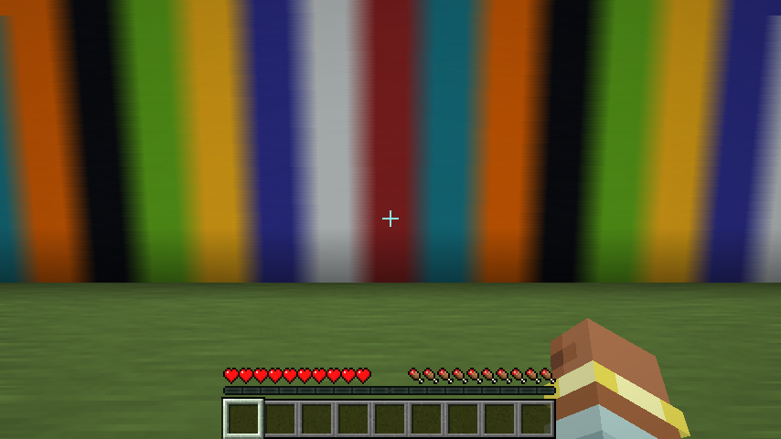

# Blur Reborn

smooth camera motion blur for minecraft 1.21.11. it reads the depth buffer to see how far every pixel moved since the last frame, so turning the camera and walking both blur the way a real camera would. your hand and the interface stay sharp.

client side fabric mod, no fabric api needed. settings through mod menu with cloth config:

- **motion blur on**: turn it off and the mod costs nothing
- **strength**: slider from 0% to 100% (default 50%). 0% is off, 50% looks like a normal camera, 100% is very strong

## download

`blur-reborn-mc1.21.11-1.0.0.jar` on the releases page. minecraft 1.21.11, fabric loader 0.16 or newer.

## why it is light

- one fullscreen pass, 14 samples per pixel with a little noise so there is no banding, plus one copy of the frame
- when you stand still (same camera, same fov) nothing is drawn at all
- when the setting is off nothing is drawn at all
- the blur length is set by exposure time, not by frames, so it looks the same at 60 or 240 fps
- teleports, dimension changes and long pauses are ignored so you never get a smear

## pictures

same spot, mod off and on. the camera turns at the same speed in every picture:

| off | 100% |
|---|---|
|  |  |

| 50% | 20% |
|---|---|
|  |  |

walking sideways (the wall and the ground blur by distance, the hand stays sharp):

| off | 100% |
|---|---|
|  |  |

standing still, off and on look the same:

| off | on |
|---|---|
|  |  |

## how it works

a mixin at the end of `LevelRenderer.renderLevel` (after the world, before the hand and the gui). a shader rebuilds each pixel's position from the depth, moves it back with the previous frame's camera and projection to get a velocity, and averages the frame along that velocity. the blur is capped at a share of the screen so fast flicks do not turn into mush.

## tests

`./gradlew runClientGameTest` builds a wall of colored blocks, fakes a steady camera turn and a steady sideways walk, and takes screenshots with the mod off and on at 100%, 50% and 20%. it also opens the cloth config screen and checks the config. it was run with and without sodium and sodium extra.

license: MIT