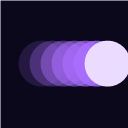
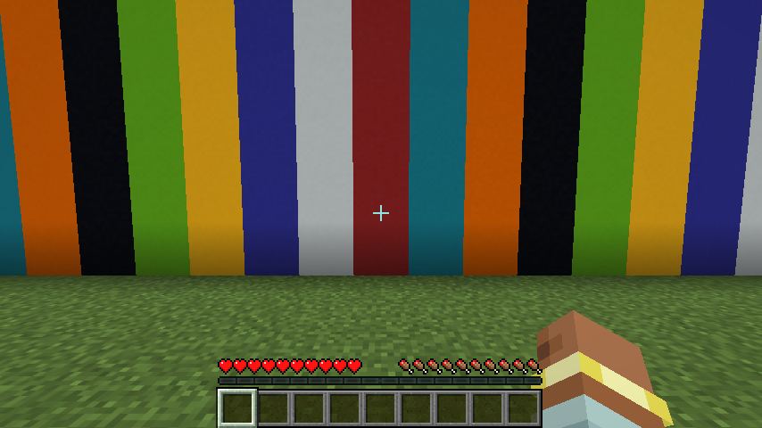
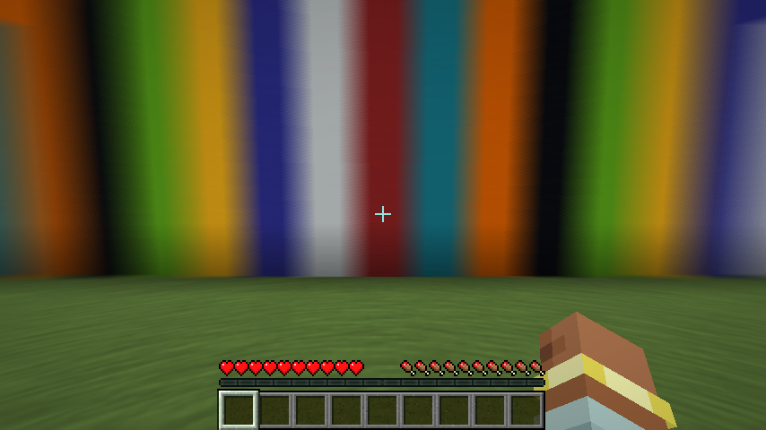
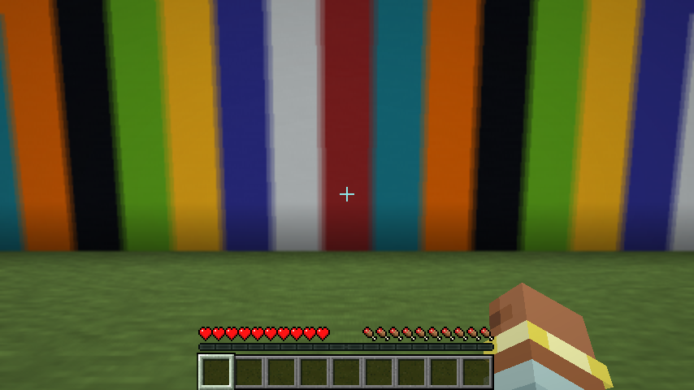
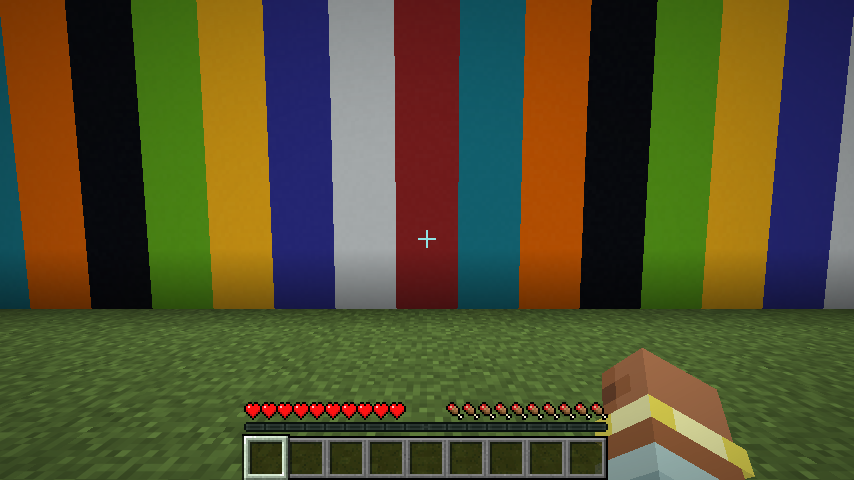
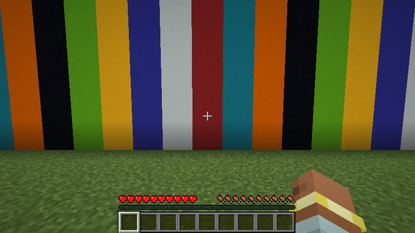
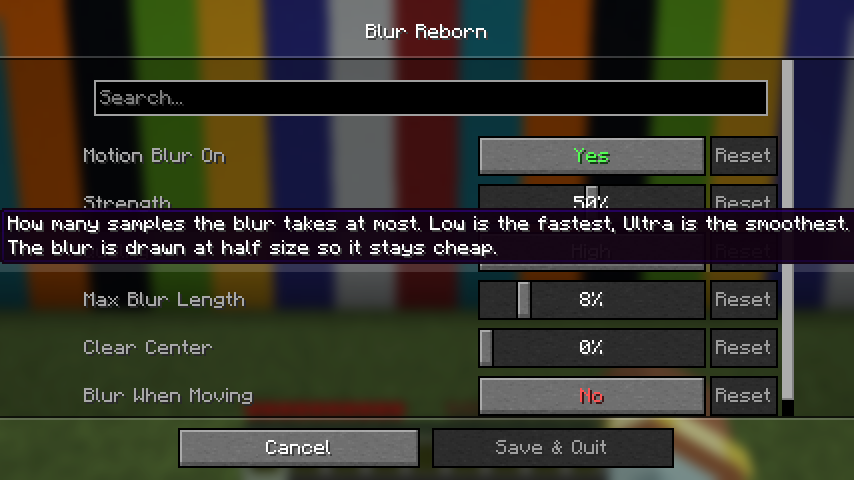

# Blur Reborn

camera motion blur for minecraft 1.21.11. the whole picture blurs when you move the camera, your hand and the interface stay sharp.

client side fabric mod. settings with the menu (key **N** or mod menu, needs [Wysss Library](https://github.com/realwysss/Wysss-Library)), or with the command `/motionblur 0-100` (needs fabric api):

- **motion blur on**: turn it off and the mod costs nothing
- **strength**: 0% to 100% (default 50%). it is how long the camera shutter stays open: 50% is 20 ms, 100% is 40 ms. 0% is off
- **quality**: low, medium, high, ultra. the most samples the blur takes (8, 12, 16 or 24)
- **max blur length**: the longest streak, as a share of the screen height (default 8%)
- **clear center**: keeps the middle of the screen sharper and blurs the edges more, like a lens (default 0%)
- **blur when moving**: also blurs by distance when you walk or strafe, not only when you turn (default off)

## download

`blur-reborn-mc1.21.11-1.4.0.jar` on the releases page. minecraft 1.21.11, fabric loader 0.16 or newer.

## how it looks

the mod remembers where the camera was over the last few milliseconds and blurs along that exact path, like a real shutter. because of that the blur is smooth and the same at 60 or 240 fps, it does not flicker when the mouse updates unevenly. no ghosting, no double images.

## why it is light

- the blur is drawn at half size and blended over the frame, so there is no full screen copy and only a quarter of the pixels take samples
- short blurs use few samples, long ones use more, up to the quality setting
- when you stand still nothing is drawn
- when the setting is off nothing is drawn at all
- teleports, dimension changes and long pauses are ignored so you never get a smear

## pictures

same spot, mod off and on. the camera turns at the same speed in every picture:

| off | 100% |
|---|---|
|  |  |

| 50% | blur when moving (walking sideways) |
|---|---|
|  |  |

standing still, off and on look the same:

| off | on |
|---|---|
|  |  |

## how it works

a mixin at the end of `LevelRenderer.renderLevel` (after the world, before the hand and the gui) saves the camera rotation and position every frame. it picks the saved camera from one shutter time ago and rebuilds the view direction of every pixel with it to get a velocity. a half size pass averages the frame along that velocity, then a second pass blends the result over the frame. the blur is capped at a share of the screen so fast flicks do not turn into mush.

all rights reserved. made by wysss.

the menu needs [Wysss Library](https://github.com/realwysss/Wysss-Library) installed.
